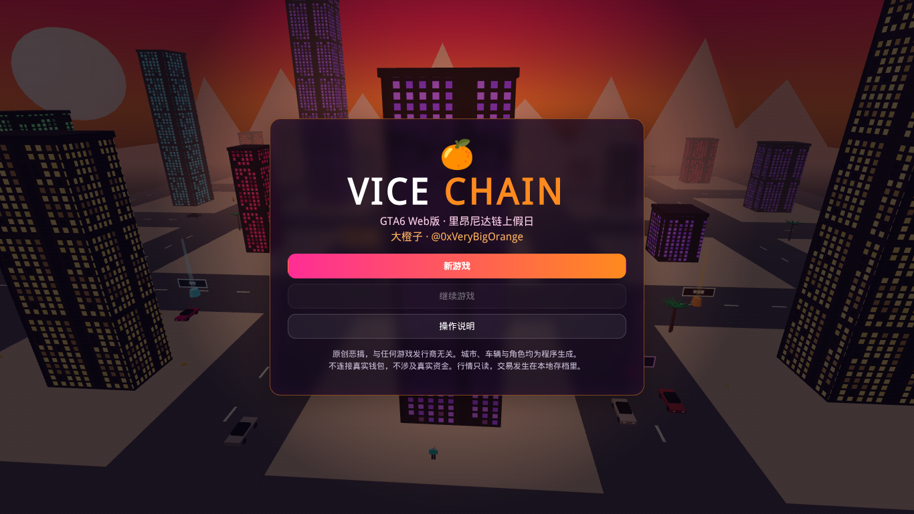
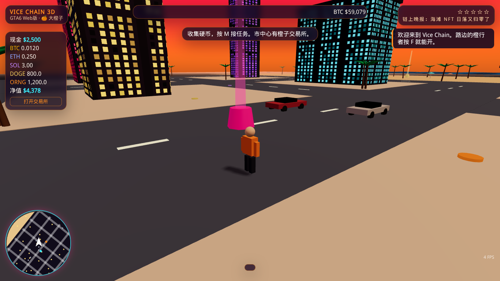
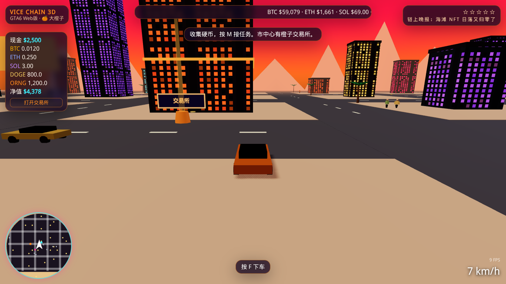
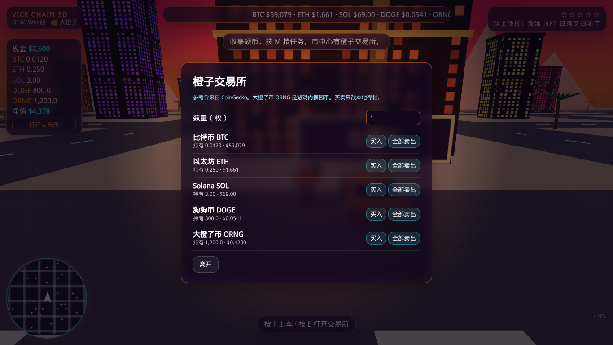
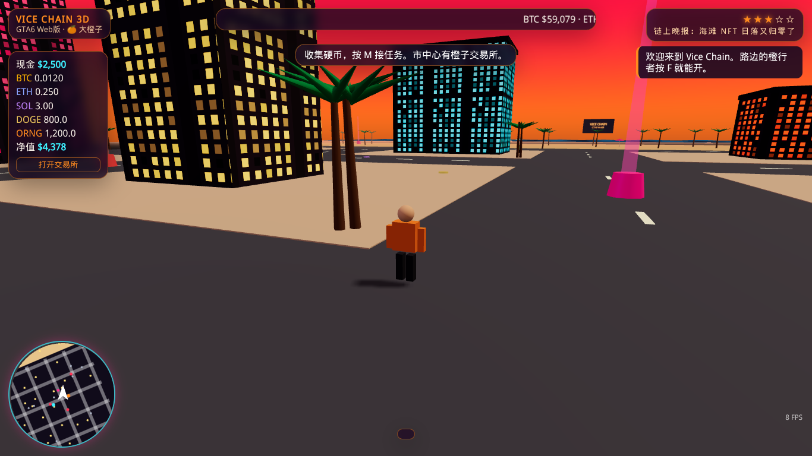
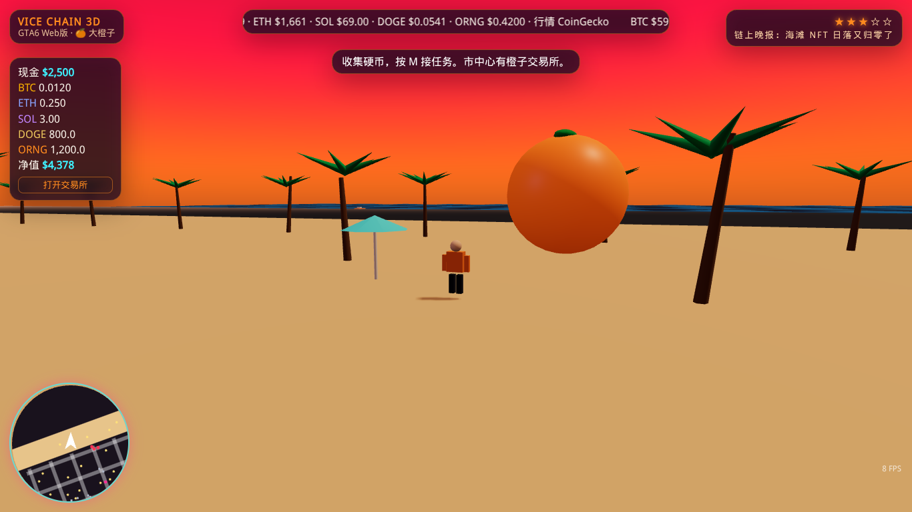

# Vice Chain 3D

**GTA6 Web版** · 里昂尼达链上假日

🍊 大橙子 · [@0xVeryBigOrange](https://github.com/0xVeryBigOrange)

在浏览器里开的第三人称开放世界。霓虹日落、棕榈树、海滩和一块程序生成的滨海城区。钱包、行情、交易所和通缉都在这张地图上。

**在线玩：** [https://0xverybigorange.github.io/gta6-web/](https://0xverybigorange.github.io/gta6-web/)

原创恶搞，和任何游戏发行商无关。城市、车、人全部是程序生成的几何体，没有使用受版权保护的素材或商标标识。不连接真实钱包，不涉及真实资金。行情只读，买卖只改本地存档。

## 画面

标题画面。Vice Chain，GTA6 Web版。



步行。霓虹楼、任务光柱、小地图和钱包。



橙行者。WASD 驾驶，右下角是时速。



橙子交易所。价格来自公开行情，失败时自动改成模拟价。



海滩、大橙子和棕榈。右上角是通缉星。





## 怎么玩

| 操作 | 作用 |
| --- | --- |
| W A S D / 方向键 | 走路；开车时加油、刹车、转向 |
| Shift | 奔跑 |
| 鼠标移动 | 转动视角。点击画面锁定鼠标 |
| 滚轮 | 拉近 / 拉远镜头 |
| F | 上车 / 下车。征用别人的车会加通缉 |
| E | 交易所、任务终端、车行、房产、拉盘 |
| M | 任务列表 |
| H | 操作说明 |
| Esc | 暂停。暂停里可以存档、关音效、回标题 |
| 空格 | 喇叭 |
| 手机 | 左下摇杆移动，右半屏滑动看四周，右侧按钮互动 |

打开菜单时，城市时间会暂停。进度写在浏览器的 `localStorage` 里，键名 `vice-chain-3d-save-v1`。

## 链上假日

- 钱包里有现金，以及 BTC、ETH、SOL、DOGE 和游戏内模因币 **ORNG（大橙子币）**。
- 顶栏行情会请求 CoinGecko，失败再试 Binance 和 CryptoCompare。三个都失败就用本地模拟价，ORNG 本身一直是模拟的。
- 人行道和沙滩上有硬币，走进去就进钱包。
- 市中心的 **橙子交易所** 按当前价格买卖。只动存档。
- **车行** 可以买链上越野和落日超跑，现金或任意币种按现价结算。起步就有一辆橙行者。
- **海滩公寓** 和 **霓虹阁楼** 买下之后，通缉消退更快。橙子安全屋一开始就能用，靠近按 E 存档。

### 四个任务

在任务终端接，一次一单，做完可以再接。

1. **冷钱包专送**：北码头取硬件钱包，限时送到海滩公寓。报酬 0.20 ETH。
2. **甩掉 SEC**：直接三星通缉。拉开距离让星级归零。被贴住会约谈失败。报酬 3 SOL 和 $2,000。
3. **模因币拉盘**：去海滩拉盘点点燃 ORNG。暴涨窗口里赶到交易所，卖掉至少 1000 枚。卖晚了会崩。报酬是价差再加 $3,000。
4. **Rug Pull 劫案**：在橙氏基金门口抢走三袋流动性，逃回安全屋。报酬 0.015 BTC。

撞行人或征用车辆都会涨通缉，最高五星。监管车会追。贴住并停下来会被约谈，罚一笔现金，SEC 和劫案任务会失败。

## 本地运行

需要 Node.js 20+。

```bash
npm install
npm run dev
```

开发地址是 [http://localhost:5173/gta6-web/](http://localhost:5173/gta6-web/)（Vite 的 `base` 是 `/gta6-web/`）。

```bash
npm run build
npm run preview
```

构建产物是纯静态文件，在 `dist/`。

## 部署

`.github/workflows/pages.yml` 会在推送到 `main` 时构建，并用 GitHub Actions 部署到 Pages。

仓库的 Pages 来源需要设成 **GitHub Actions**。设好并合并到 `main` 之后，页面在：

https://0xverybigorange.github.io/gta6-web/

## 技术

- [Vite](https://vitejs.dev/) + [Three.js](https://threejs.org/)
- 程序化城市、实例化的棕榈、方向光阴影
- 没有后端。行情是浏览器直接请求公开接口
