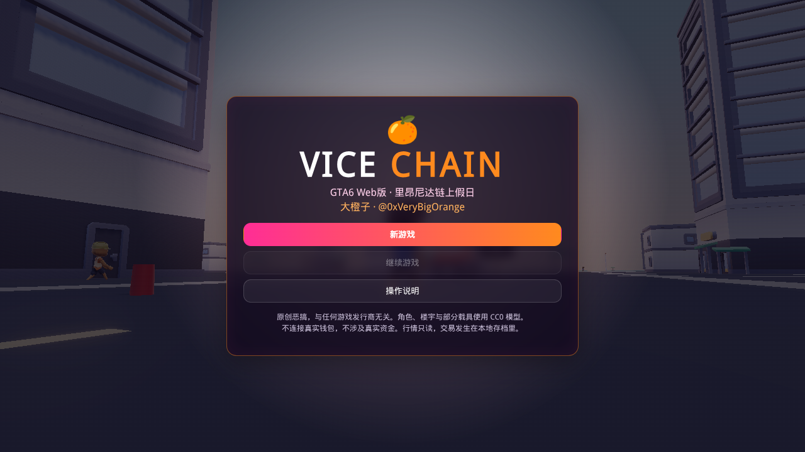
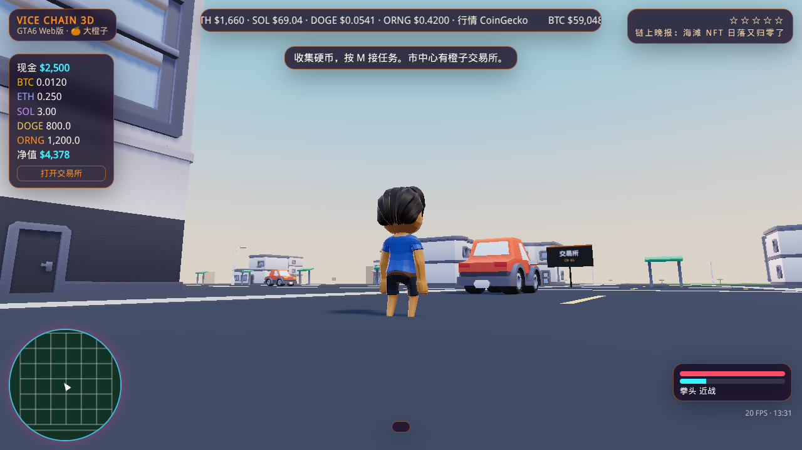
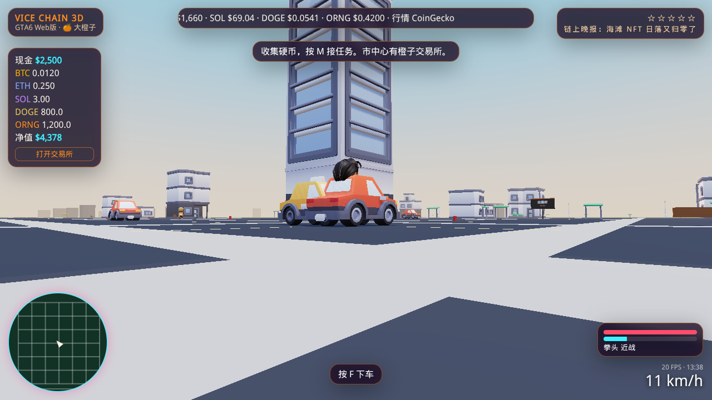
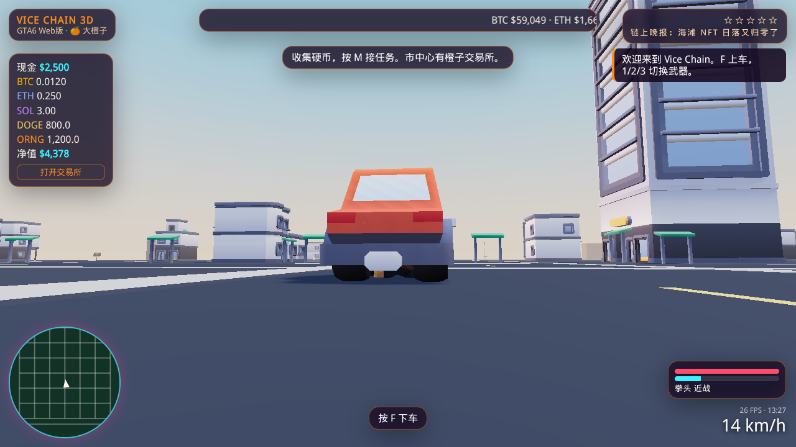
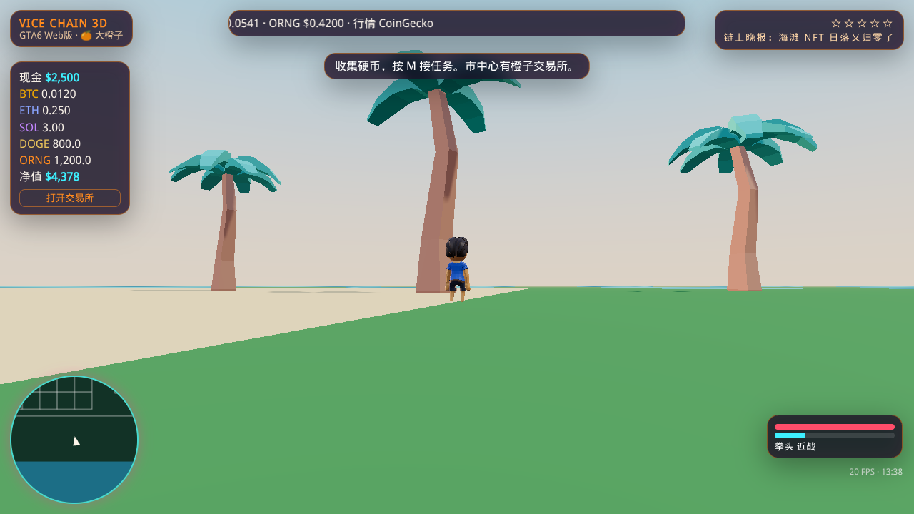
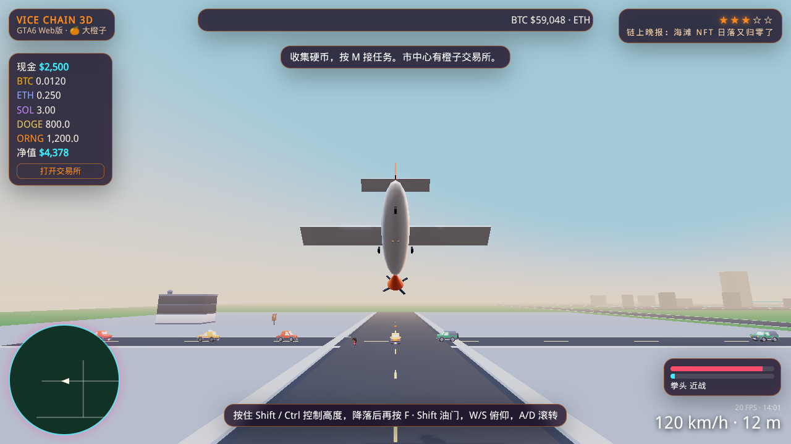
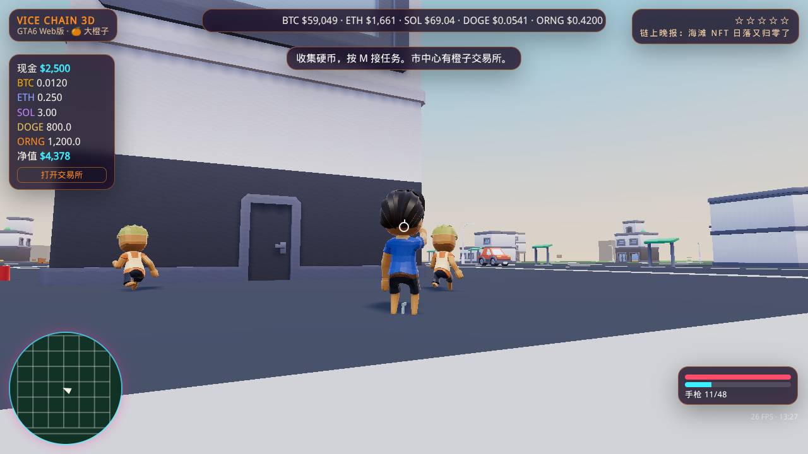

# Vice Chain 3D

**GTA6 Web版** · 里昂尼达链上假日

🍊 大橙子 · [@0xVeryBigOrange](https://github.com/0xVeryBigOrange)

浏览器里的第三人称开放世界。市中心、海滩、郊区、高速公路、机场和港口连在一张大地图上。可以开车、骑摩托、开船、开直升机、从跑道起飞，也可以近战和开枪。钱包、行情、交易所和通缉都还在。

**在线玩：** [https://0xverybigorange.github.io/gta6-web/](https://0xverybigorange.github.io/gta6-web/)

原创恶搞，和任何游戏发行商无关。没有使用受版权保护的角色、载具或商标标识。不连接真实钱包，不涉及真实资金。行情只读，买卖只改本地存档。

## 画面

标题画面。



带骨骼的角色，身后是带窗户和门面的楼。



市中心的楼和车流。



驾驶。时速在右下角。



海滩、沙地和棕榈。



轻航从机场拉起来。右下角是高度。



开枪之后通缉会涨。右下角是血、护甲和弹药。没有血腥，只有短暂的火花。



## 怎么玩

| 操作 | 作用 |
| --- | --- |
| W A S D / 方向键 | 走路；开车、骑车、开船时加油、刹车、转向 |
| Shift | 奔跑；飞机加油门；直升机上升 |
| Ctrl | 飞机收油门；直升机下降 |
| 鼠标移动 | 转动视角。点击画面锁定鼠标 |
| 滚轮 | 拉近 / 拉远镜头 |
| 鼠标左键 | 攻击。拳头、手枪、步枪都吃这个键 |
| 1 / 2 / 3 | 拳头 / 手枪 / 步枪 |
| R | 换弹 |
| F | 进入或离开任何载具，包括路人的车。不是自己的会加通缉 |
| E | 交易所、任务终端、车行、房产、拉盘 |
| M | 任务列表 |
| H | 操作说明 |
| Esc | 暂停。暂停里可以存档、关音效、回标题 |
| 空格 | 车上喇叭；直升机上升 |
| 手机 | 左下摇杆移动，双击摇杆跳跃，右半屏滑动看四周，右下角按钮开火、上车、互动。钱包收成顶部「净值」按钮。竖屏会提示横过来 |

新游戏会先带你走一段教程：冲刺到光柱、上车、沿黄色 GPS 开到任务终端、按 E。教程之后去找橙爪，故事一共八章，人物都是原创的加密圈讽刺角色。小地图上的黄点是他们的据点。

可以用邮箱注册登录，第一次要取一个 2 到 16 字的昵称。游客也能玩，进度只留在这台设备。登录后，净值、声望、等级和故事章节会写进排行榜，暂停菜单和画面上的「榜」都能打开。同一条频道里的玩家会看到彼此的人和昵称。

路边仍有加密 ATM、街头竞速、夜班出租、武器店、服装店、NFT 画廊和高速特技门。声望攒起来会升级。每天有一个小目标。

走路大约 5 米/秒，冲刺大约 9 米/秒，空格可以跳，撞上矮障碍时跳一下能翻过去。车也更快，方便在这张大地图上跑。

飞机要在跑道上把油门拉起来，速度够了会离地，W/S 控制俯仰，A/D 滚转。直升机能悬停。船离开水面几乎爬不动。

打开菜单时，城市时间会暂停。游客进度写在浏览器的 `localStorage` 里，键名 `vice-chain-3d-save-v2`。登录之后同一台设备用 `vice-chain-3d-save-v2:账号` 分开存，净值、声望、等级、完成数和故事章节另外同步到 Supabase 的 `gta6_scores`。排行榜读的是视图 `gta6_leaderboard`。联机用 Realtime 频道 `gta6-world`，只同步位置和昵称。

## 链上假日

- 钱包里有现金，以及 BTC、ETH、SOL、DOGE 和游戏内模因币 **ORNG（大橙子币）**。
- 顶栏行情会请求 CoinGecko，失败再试 Binance 和 CryptoCompare。三个都失败就用本地模拟价，ORNG 本身一直是模拟的。
- 路边有硬币，走进去就进钱包。
- 市中心的 **橙子交易所** 按当前价格买卖。只动存档。
- **车行** 可以买轿车、越野、掀背、出租、赛车、摩托、快艇、直升机和轻航。现金或任意币种按现价结算。起步就有一辆街车。SEC 巡逻车不卖，只能征用。
- **海滩公寓** 和 **霓虹阁楼** 买下之后，通缉消退更快。橙子安全屋靠近按 E 存档。倒下会在橙子医院醒来。

### 六个任务

在任务终端接，一次一单，做完可以再接。

1. **冷钱包专送**：港口取硬件钱包，限时送到海滩公寓。报酬 0.20 ETH。
2. **甩掉 SEC**：直接三星通缉。拉开距离让星级归零。被贴住会约谈失败。报酬 3 SOL 和 $2,000。
3. **模因币拉盘**：去海滩拉盘点点燃 ORNG。暴涨窗口里赶到交易所，卖掉至少 1000 枚。卖晚了会崩。报酬是价差再加 $3,000。
4. **Rug Pull 劫案**：抢走三袋流动性，逃回安全屋。报酬 0.015 BTC。
5. **航线投送**：到机场登上轻航，穿过海上三道橙环。报酬 0.020 BTC。
6. **港口清场**：解决码头上的三名护卫，再把直升机拉到 12 米以上。报酬 5 SOL。

打路人、征用载具都会涨通缉，最高五星。SEC 会追过来开枪。贴住并停下来会被约谈。血量归零会送到医院，SEC、劫案和港口任务会失败。

## 素材

允许再分发的免费模型，游戏里做了缩放和重新上色：

- 角色：Quaternius Ultimate Modular Men（Casual、Worker、SWAT），CC0。带眼睛、眉毛、头发和 24 段动作（走、跑、待机、挥手、出拳、开枪、受击、倒地、翻滚）。经 [fatal-funnel-public](https://github.com/euuuuuuan/fatal-funnel-public/tree/main/packages/renderer/assets/models/quaternius-men) 里的 GLB 获取。原包说明见 [Quaternius Ultimate Modular Characters](https://quaternius.com/packs/ultimatemodularcharacters.html)。主角是橙色外套的 Casual，路人用同一套骨骼换了工人和特警外形。
- 楼、车、船、棕榈、路灯、手枪：Kenney，CC0。经 [shorepine/kenney](https://github.com/shorepine/kenney) 镜像获取。车和楼用了各自套件里的 `Textures/colormap.png`。
- 天空的环境光：Poly Haven `venice_sunset` 1k HDR，CC0。

摩托、直升机和轻航是这个项目里做的原创机体，没有使用他人的飞机或摩托模型。道路、人行道、长椅、消防栓和水面也是项目内生成的。

## 本地运行

需要 Node.js 20+。

```bash
npm install
npm run dev
```

开发地址是 [http://localhost:5173/gta6-web/](http://localhost:5173/gta6-web/)（Vite 的 `base` 是 `/gta6-web/`）。

```bash
npm run build
npm run preview
```

构建产物是纯静态文件，在 `dist/`。

## 部署

`.github/workflows/pages.yml` 会在推送到 `main` 时构建，并用 GitHub Actions 部署到 Pages。

https://0xverybigorange.github.io/gta6-web/

## 技术

- [Vite](https://vitejs.dev/) + [Three.js](https://threejs.org/)
- glTF 角色与城市场景，分区加载，远处用简化体块
- ACES 色调、泛光、指数雾、跟随玩家的阴影和昼夜光照
- 没有后端。行情是浏览器直接请求公开接口

画面是带 PBR 的低多边形风格，不是实拍照片。笔记本浏览器能跑；无独立显卡的软件渲染会掉帧，不代表正常机器上的速度。
